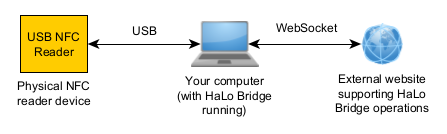

# HaLo Bridge

HaLo Bridge is a special tool dedicated for desktop computers. The tool is provided in a form of native program
for your platform (Windows, Linux, Mac OS). Once you launch HaLo Bridge, it will connect with your physical
USB NFC reader and expose it as a WebSocket Server.

In particular, it means that whenever you will have HaLo Bridge tool running on your computer, any authorized
website will be able to interact directly with your USB NFC reader in order to sign some information with HaLo
tags.

## Architecture graph



## Using HaLo Bridge

### End-user side

1. Obtain an NFC PC/SC reader compliant with ISO 14443A protocol and your operating system.
2. Download HaLo Tools distribution from this repository and install it (or simply unpack it,
if no installer is provided for your platform).
3. Run `halo-bridge` binary (on MacOS: "HaLo Bridge Server" straight from Launchpad).
4. The terminal window with HaLo Bridge Server and the diagnostic web page should automatically pop up.
5. If the auto-diagnostics is successful, you can navigate to any website that supports HaLo Bridge
and follow the instructions provided by the website in order to perform HaLo commands with the physical tags.
Example website: [https://bulk.vrfy.ch/](https://bulk.vrfy.ch/).

### Web application's developer side

#### 1. Find HaLo Bridge address

Use `haloFindBridge()` library function in order to obtain the HaLo Bridge address:

```javascript
import {haloFindBridge} from '@arx-research/libhalo/api/web.js';
   
let wsAddress = await haloFindBridge();
```

You shouldn't hardcode HaLo Bridge address, as it might slightly differ depending on the user's browser and platform where HaLo Bridge is running. The abovementioned function call should always return the correct, operational address.

Please note that this function would throw an exception if the user doesn't have `halo-bridge` up and running,
or for any reason it's not possible to connect with the HaLo Bridge. In case this call throws an exception,
you should ask the user to check if `halo-bridge` is running on their computer.

#### 2. Connect with WebSocket

Use whatever WebSocket Client suits you and connect to the `wsAddress` obtained from the previous step.

**Important:** The HaLo Bridge WebSocket Server might immediately close the connection with 4002 reason code. In such a case, it means that your website needs to obtain user's consent in order to use HaLo Bridge. You should detect the close code 4002 and redirect the user to the consent page.

*Example:*
```javascript
    wsp.onClose.addListener(event => {
        if (event.code === 4002) {
            // we need to obtain user's consent in order to use HaLo Bridge
            window.location.href = 'http://127.0.0.1:32868/consent?website=https://your-website.com/path';
        } else {
            console.log('Connection closed due to: [' + event.code + '] ' + event.reason);
        }
    });
```

Where `https://your-website.com/path` is the address where the user should be redirected after providing a consent. The origin corresponding to the provided URL will be authorized to use HaLo Bridge for this session. Namely, any web page hosted under `https://your-website.com` will be then able to use HaLo Bridge, no matter of the exact URL path, query string or fragment.

The exact way of detecting the reason of WebSocket connection close event depends on the WebSocket library you are using on the client side. When in doubt, please review the documentation of your WebSocket library.

#### 3. Handle incoming events

On your WebSocket client, you will be receiving certain incoming messages. All messages are encoded in the JSON
format with the following structure:

```
{
    "event": "<event name>",
    "uid": "<uid>",
    "data": { /* ... depending on event ... */ }
}
```

Where the `event` key is a string representing the name of particular event.

Possible incoming events are the following:

* `ws_connected` - welcome event sent by the server, contains server's version information in `data.server_version`;
* `reader_added` - a new NFC reader was detected, the reader's name will be provided as `data.reader_name`; 
* `reader_removed` - the existing NFC reader was disconnected, the reader's name will be provided as `data.reader_name`;
* `handle_added` - a reader has detected new HaLo tag (`data.reader_name` - reader's name, `data.handle` - random value, a handle to the connected tag);
* `handle_removed` - a reader has detected that HaLo tag was un-tapped (`data.reader_name` - reader's name, `data.handle` - random value, a handle to the connected tag);
* `handle_not_compatible` - a reader has detected a tag, but it's not compatible with HaLo and thus any interaction will be impossible (`data.reader_name` - reader's name, `data.message` - description why the tag is not compatible);
* `exec_success` - HaLo command execution has succeeded, (`uid` - identifier of the command request; `data.*` - command execution result);
* `exec_exception` - HaLo command failed to execute (`data.exception.message` - exception message, `data.exception.stack` - full call stack of the exception);

#### 4. Send some commands for execution

Once you receive `handle_added` event, there will be the tag's handle associated with it (`data.handle`). You can store that handle and use it
to execute HaLo commands against the connected tag, as long as it's present on the NFC reader.

In order to do so, you need to send such a JSON to the WebSocket:
```
{
    "type": "exec_halo",
    "handle": handle,
    "uid": uid,
    "command": {
        "name": "sign",
        "message": "010203",
        "keyNo": 1
    }
}
```

Where `handle` is the tag's connection handle, and `uid` can be set to a random unique value. The `uid` value returned
in `exec_success` or `exec_exception` events will correspond to the `uid` that you have provided here.

An example HaLo command is provided in the `command` object of the request. Please check [HaLo Command Set](https://github.com/arx-research/libhalo/blob/master/docs/halo-command-set.md)
for the detailed description of commands that may be requested.

## Self-signed TLS certificate

In case of Mac OS platform, the HaLo Tools installer needs to generate a self-signed TLS certificate and mark it as trusted in the system. This is due to the fact that Safari would raise a mixed-content error if a secure external website would attempt to connect to an unsecured WebSocket on localhost, which is not the case for other browsers.

Due to that limitation, the installer will ask if you agree to generate a TLS certificate. The certificate will be stored at `/Library/Application Support/HaLo Bridge/` location (a root-owned directory; the private key is readable only by the user who ran the installer). The generated certificate would only cover the `halo-bridge.localhost` domain (and the legacy `halo-bridge.local` domain, which is still probed by older versions of LibHaLo). It will be also clearly marked that it's not a Certificate Authority (to prevent issuing any additional trusted certificates on top of this one) and that it's purposed only for TLS Web Server authentication.

### Manually generating a certificate
If you wish, it is possible to manually generate a certificate and mark it as trusted in the system.

Run the following commands in a root shell started with `sudo -s` from your regular user account:

```bash
# create a root-owned directory for the certificate
mkdir -p "/Library/Application Support/HaLo Bridge"
cd "/Library/Application Support/HaLo Bridge"

# generate new local certificate
openssl genrsa -out private_key.pem 2048
openssl req -new -sha256 -key private_key.pem -out server.csr -subj '/CN=halo-tools (Local Certificate)/'
openssl req -x509 -sha256 -days 3650 -extensions HALO -config <(printf "[HALO]\nsubjectAltName='DNS:halo-bridge.localhost,DNS:halo-bridge.local'\nbasicConstraints=critical,CA:FALSE\nkeyUsage=critical,digitalSignature,keyEncipherment\nextendedKeyUsage=critical,serverAuth") -key private_key.pem -in server.csr -out server.crt

# make the private key readable only by your user (halo-bridge runs as your user)
chown "$SUDO_USER:$(id -gn "$SUDO_USER")" private_key.pem
chmod 600 private_key.pem

# add certificate to the trust list
security add-trusted-cert -d -r trustRoot -k /Library/Keychains/System.keychain server.crt

# add halo-bridge.localhost and halo-bridge.local domains to /etc/hosts if they don't exist yet
for BRIDGE_HOSTNAME in halo-bridge.localhost halo-bridge.local; do
  grep -qE "^[^#]*[[:space:]]${BRIDGE_HOSTNAME//./[.]}([[:space:]]|$)" /etc/hosts || echo "127.0.0.1  $BRIDGE_HOSTNAME" >> /etc/hosts
done
```

The HaLo Bridge would automatically detect the certificate upon the next startup and start the Secure WebSocket server at `wss://halo-bridge.localhost:32869`, in addition to the normal (unsecured) WebSocket endpoint at `ws://127.0.0.1:32868`.

### Why `halo-bridge.localhost`

Older versions used the `halo-bridge.local` domain. The `.local` top-level domain is reserved for multicast DNS (RFC 6762), so on systems without the `/etc/hosts` entry every lookup was multicast to the local network, and on macOS `.local` lookups may be delayed or conflict with VPN/corporate networks that use `.local` internally. The `.localhost` top-level domain is reserved for loopback (RFC 6761); Chrome, Edge and Firefox resolve it to the local machine without any DNS lookup.

During the transition period, LibHaLo probes both `wss://halo-bridge.localhost:32869` and `wss://halo-bridge.local:32869`, and the installer issues a certificate covering both names.

## Example project

Please check GitHub [arx-research/libhalo-example-reactjs-bridge](https://github.com/arx-research/libhalo-example-reactjs-bridge) project for the complete project example.
